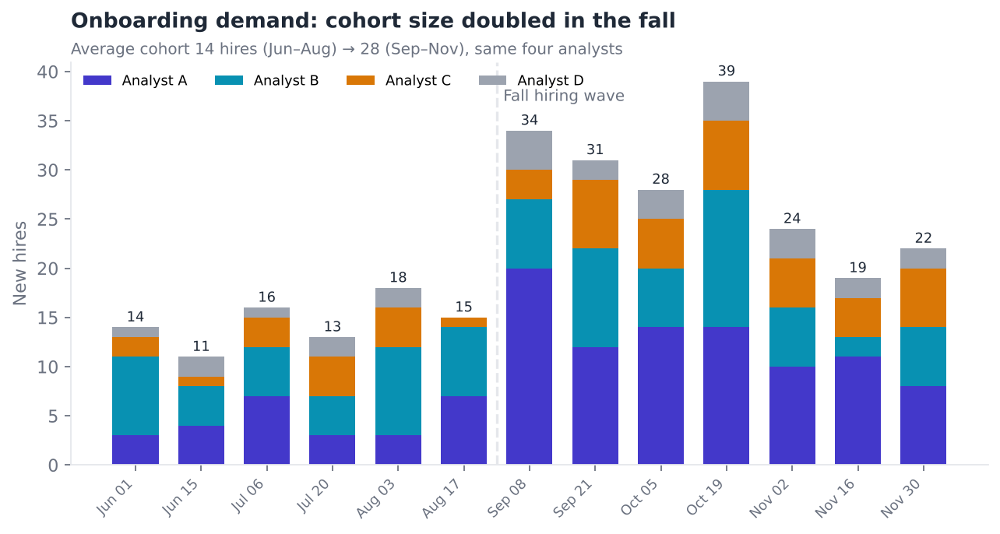
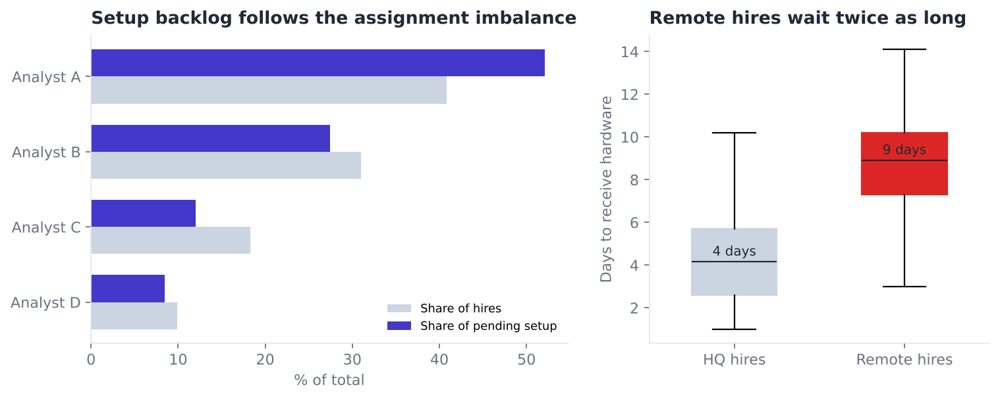
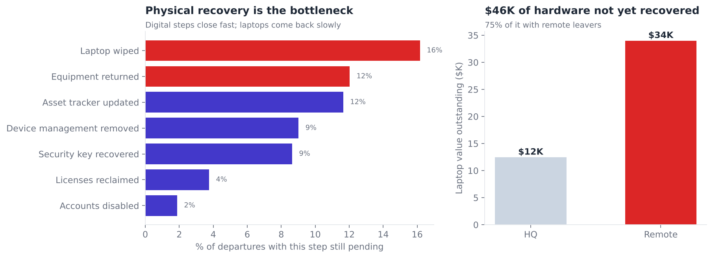
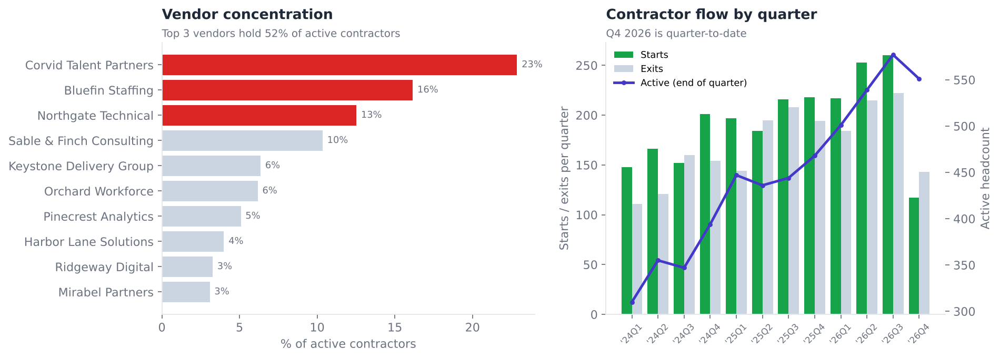

# Workforce Lifecycle Operations

**One operational view of how people join, leave, and are contracted, built to answer the questions leadership asks: Can we absorb the hiring plan? What equipment and access are still outstanding? How dependent are we on a few vendors?**

### ▶ [Open the live demo](https://k-b-c-04.github.io/workforce-lifecycle-ops/) · 📄 [Read the operations brief](OPS_BRIEF.md)

> **All data is synthetic.** *Larkspur & Vane* is a fictional company. Every person, vendor, serial number, and figure is generated by [`data/generate_data.py`](data/generate_data.py). The original tools were built in Google Sheets for a real IT operations team; this repo recreates them as a standalone demo without any company or employee data.



---

## The operating problem

Workforce operations usually run on separate trackers: one sheet per new-hire cohort, another for offboarding, a third for contractors. Each answers "what's the status of this person?" None answers the questions that matter to the business:

- **Capacity:** is the team sized and balanced for the hiring plan, or is work piling up on one person?
- **Lead time:** do new hires, especially remote ones, have equipment and access on day one?
- **Risk:** how much company hardware and access is still out there after people leave?
- **Vendor strategy:** how concentrated is contractor capacity, and where do we depend on it most?

This project consolidates all three stages into one data model and one view, then turns it into decisions.

## What it found (synthetic data)

| | Finding | Recommended action |
|---|---|---|
| **Capacity** | Average cohort size doubled from **14 to 28** in the fall. One of four analysts carries **41%** of hires and **52%** of open setup items. | Round-robin assignment and a cap on open items per analyst |
| **Lead time** | Remote hires wait **9 days** for hardware vs **4** at HQ, and remote hires are a third of intake. | Ship from the offer-accepted date, not the cohort list |
| **Asset risk** | **32 laptops (~$46K)** not yet recovered; **75%** of the value sits with remote leavers, whose unreturned rate is **21%** vs **5%** at HQ. | Prepaid return kits on day one of notice, with escalation at 14 days |
| **Vendor strategy** | **3 of 15** vendors supply **52%** of active contractors. Client Success holds **41%** of all contractors. | Vendor share ceiling and a second source for Client Success |

The full reasoning, owners, and success measures are in the **[operations brief](OPS_BRIEF.md)**.







## The demo

The [live demo](https://k-b-c-04.github.io/workforce-lifecycle-ops/) has four views:

| View | What it does |
|---|---|
| **Leadership read-out** | Headline KPIs across the lifecycle, the four decisions above, monthly intake vs departures, open items by stage |
| **Onboarding** | Cohort chips to filter by start-date class; quarter, analyst and work-mode filters; workload and pending-setup charts; an intake form to add a hire |
| **Offboarding** | A directory of departures with each one's 7-step recovery checklist (return, security key, accounts, device management, licenses, tracker, wipe), legal-hold handling, and completion metrics |
| **Contractors** | Filters by status, region, department and vendor; vendor concentration; quarterly starts, exits and active headcount; department and country mix |

Forms in the demo add records to the current browser tab only.

## How it's built

| Path | What it is |
|---|---|
| [`docs/index.html`](docs/index.html) | The interactive demo: one self-contained page (HTML, CSS, JavaScript and Chart.js), served by GitHub Pages |
| [`analysis/analyze.py`](analysis/analyze.py) | The analysis behind the brief: capacity, lead time, recovery risk, vendor concentration; renders the charts |
| [`data/generate_data.py`](data/generate_data.py) | Generates the fictional company's three datasets with realistic operating patterns |
| [`data/*.csv`](data/) | Onboarding (284 hires, 13 cohorts), offboarding (266 departures), contractors (2,750 engagements, 15 vendors, 12 countries) |
| [`OPS_BRIEF.md`](OPS_BRIEF.md) | One-page leadership brief: findings, recommendations, owners, measures |

**Run it locally**
```bash
pip install pandas matplotlib numpy
cd data && python generate_data.py && cd ..   # regenerate the data (optional)
python analysis/analyze.py                     # print findings, write charts to images/
python -m http.server -d docs 8000             # open http://localhost:8000
```

## Design choices

- **One record per person per stage.** Each stage keeps its own fields (checklists, cohorts, vendors), but all three share department, location, work mode and owner, so the view can compare them side by side.
- **Checklists, not just statuses.** "In progress" hides where the work is stuck. Tracking each step separately is what showed that physical recovery, not account removal, is the bottleneck.
- **Workload framed as capacity.** Analyst views are there to balance assignments and staffing, not to rank individuals.
- **Privacy by design.** The real versions of these tools hold employee names, device serials and vendor contracts. Public versions use synthetic data only.

---

*Part of [Kamsi's portfolio](https://github.com/K-B-C-04).*
